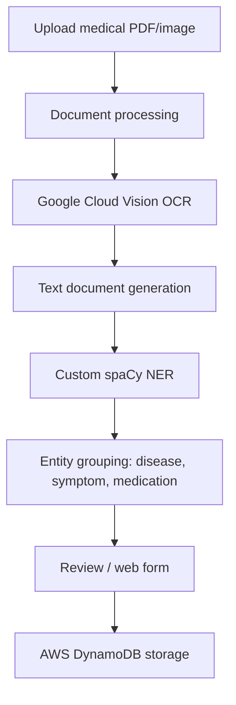

# Intelligent E-Health Engine for Bangladesh

Research project: an e-health document-processing prototype that extracts text from medical documents, recognizes disease/symptom/medication entities with a custom spaCy NER model, and stores structured results in AWS DynamoDB. The repository preserves the web application backend and Custom NER training/data-preparation code as separate components.

## System workflow

## Repository structure

- `backend/`: Flask web application, document extraction, entity classification, templates, static assets, and DynamoDB integration.
- `custom_ner/`: annotation/training assets, spaCy configs, training notebook, and inference/integration code.
- `docs/`: setup, security, and repository publishing notes.

## Main backend modules

- `backend/flaskrun.py`: Flask routes for upload, classification, review, and storage.
- `backend/textExtraction.py`: PDF page rasterization, Google Cloud Vision OCR, DOCX generation/combination, and PDF conversion.
- `backend/EntityClassification.py`: loads the trained spaCy model and groups recognized entities into diseases, symptoms, and medications.
- `backend/wareHouse.py`: AWS DynamoDB table creation and storage.
- `custom_ner/Custom_NER_Asad.ipynb`: custom NER data preparation/training workflow.
- `custom_ner/config.cfg`, `base_config.cfg`: spaCy training configuration.

## Entity labels

The integration code expects the custom model to produce `DISEASE`, `SYMPTOM` (also supports `SYMPTOMS` in the web classifier), and `MEDICATION` labels.

## Setup

See [docs/SETUP.md](docs/SETUP.md). This prototype depends on external Google Cloud Vision and AWS DynamoDB services and a locally trained spaCy model. Those credentials and model weights are not included.

## Research results

Reported model metrics should be included only when traceable to the research report or training/evaluation outputs. This repository does not claim to reproduce the report's metrics automatically.

## Security and privacy

Medical text may contain sensitive information. Do not commit patient documents, credentials, API keys, cloud service-account JSON, or identifiable medical datasets. The original uploaded scripts contained hard-coded AWS and Google Cloud credential paths/values; these have been removed from this curated package. **Revoke the exposed AWS access key and rotate any associated credentials before using the cloud service again.** See [SECURITY.md](docs/SECURITY.md).

## Limitations

Academic prototype; OCR, model inference, cloud storage, and the web interface require additional configuration. Review and harden upload handling, authentication, access control, storage policies, error handling, and deployment settings before production use.
