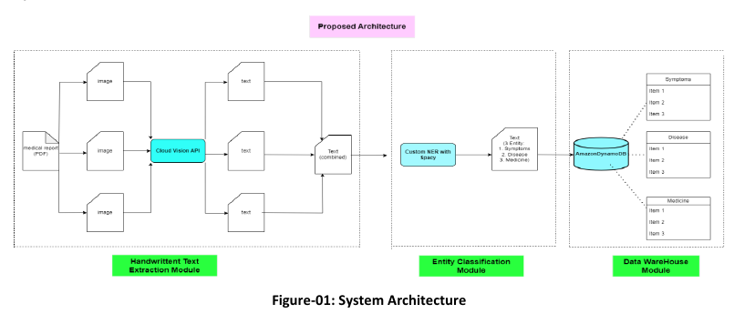
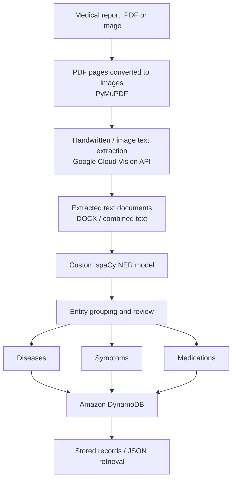
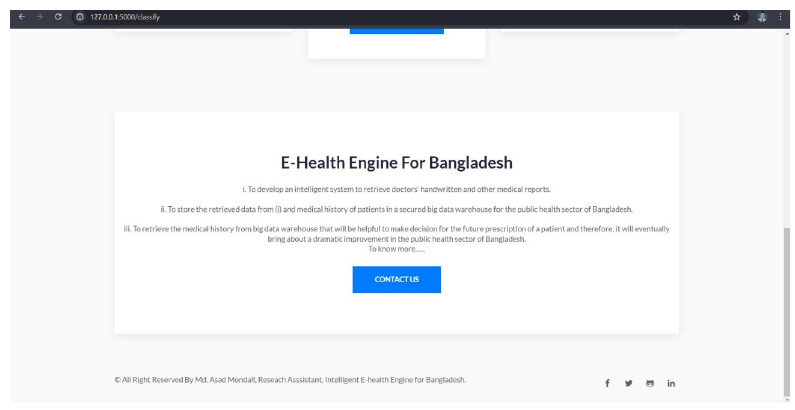
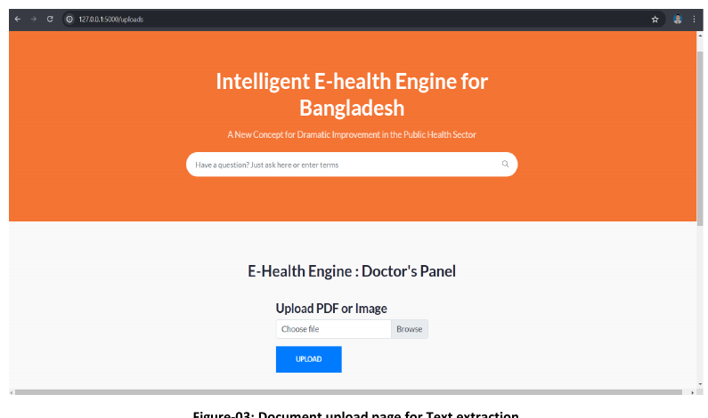
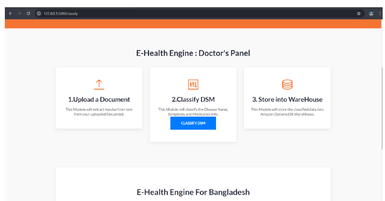
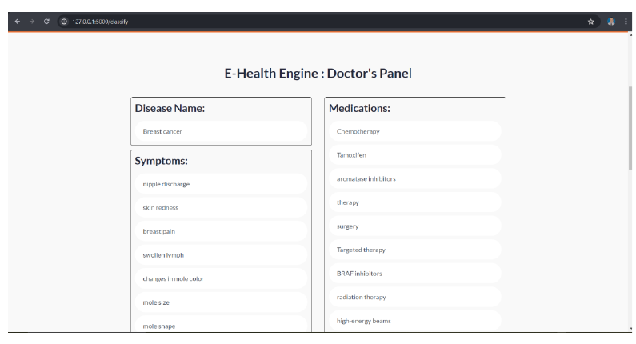
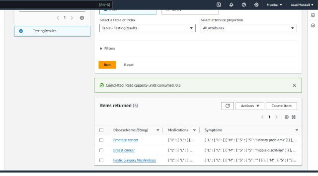
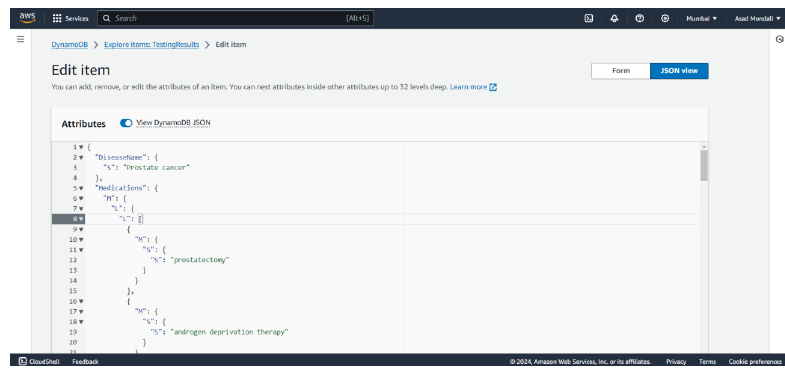

# Intelligent E-Health Engine for Bangladesh

**Research prototype for extracting, classifying, and storing medical entities from clinical documents.**

The project explores an NLP-assisted workflow for digitizing medical reports and organizing information for healthcare data management. The prototype accepts PDF/image documents, extracts text (including handwritten content through Google Cloud Vision), identifies disease, symptom, and medication entities using a custom spaCy NER model, and stores structured results in Amazon DynamoDB.

> This repository documents an academic research prototype. It is not a clinical decision-support product and must not be used to make medical decisions.

## Research objectives

As stated in the project report, the objectives were to:

1. Retrieve information from doctors' handwritten and other medical reports.
2. Store extracted information and patient medical history in a data warehouse.
3. Enable retrieval of medical history to support future prescription-related decision-making research.

## Central system architecture

The system is organized into three main modules: Handwritten Text Extraction, Entity Classification, and Data Warehouse.



### End-to-end workflow



## Processing stages and demonstrated outputs

The following interface and output screenshots are taken from the project report and illustrate the prototype's demonstrated workflow.

### 1. Homepage

The homepage introduces the E-Health Engine and its intended objectives.



### 2. Upload a medical document

The doctor-facing demo interface accepts a PDF or image document for text extraction.



### 3. Processing and classification workflow

The interface presents the three steps: upload a document, classify medical entities, and store the results in the warehouse.



### 4. Custom NER output

The custom spaCy model extracts and groups disease names, symptoms, and medications from the processed text for review.



### 5. Data warehouse output

The classified data is stored in Amazon DynamoDB. The report demonstrates stored records in the table interface.



### 6. Structured JSON representation

A stored record can be inspected in JSON format, including disease, medication, and symptom fields.



## Custom medical Named Entity Recognition

The entity-classification component uses a custom-trained spaCy model. The training data was annotated for the medical entity categories used in the project:

- `DISEASE` — disease names
- `SYMPTOMS` / `SYMPTOM` — symptom mentions (label spelling varies between report/code artifacts)
- `MEDICATION` — medication and treatment names as annotated in the project data

The `custom_ner/` directory contains the dataset preparation and model-training implementation, including notebook, training configurations, annotated data, and integration scripts. See its contents and [setup documentation](docs/SETUP.md) for details.

### Reported model evaluation

The report's training log identifies epoch 120 as the best checkpoint shown:

| Metric | Reported result |
|---|---:|
| Entity F1 (`ENTS_F`) | **82.93%** |
| Precision (`ENTS_P`) | **85.00%** |
| Recall (`ENTS_R`) | **80.95%** |
| Score | 0.83 |

These are figures reported in the project report; this repository does not claim that the model has been independently retrained to reproduce them.

## Repository structure

```text
EHealthResearch/
├── README.md
├── LICENSE
├── .gitignore
├── backend/
│   ├── flaskrun.py              # Flask web application and routes
│   ├── textExtraction.py        # PDF/image processing and OCR workflow
│   ├── EntityClassification.py  # Custom NER inference and entity grouping
│   ├── wareHouse.py             # DynamoDB storage integration
│   ├── requirements.txt
│   ├── templates/               # Web interface
│   └── static/                  # CSS, JavaScript, and assets
├── custom_ner/
│   ├── Custom_NER_Asad.ipynb    # Dataset preparation / training notebook
│   ├── integrated.py             # Integrated processing workflow
│   ├── warehouse.py              # Warehouse integration utilities
│   ├── training_data.json
│   ├── train_data.spacy
│   ├── test_data.spacy
│   ├── train_file.txt
│   ├── config.cfg
│   └── base_config.cfg
└── docs/
    ├── SETUP.md
    ├── SECURITY.md
    ├── REPOSITORY_CHECKLIST.md
    └── screenshots/              # Report architecture and stage outputs
```

## Main backend components

| Component | Role |
|---|---|
| `flaskrun.py` | Flask application and document-processing routes/interface |
| `textExtraction.py` | PDF page conversion, Google Cloud Vision OCR, and text/document processing |
| `EntityClassification.py` | Loads custom spaCy NER model and organizes detected entities |
| `wareHouse.py` | AWS DynamoDB table/storage integration |
| `custom_ner/` | Dataset preparation, spaCy training configuration, notebook, and integration scripts |

## Technology stack

- **Python / Flask** — backend web application
- **PyMuPDF (fitz)** — PDF page processing
- **Google Cloud Vision API** — OCR/text detection for image-based and handwritten documents
- **spaCy** — custom Named Entity Recognition
- **Amazon DynamoDB** — NoSQL data storage
- **DOCX tooling** — extracted text document generation and combination

## Setup and configuration

See [docs/SETUP.md](docs/SETUP.md) for the environment and configuration walkthrough. External services require separately configured credentials and access:

- Google Cloud Vision API credentials
- AWS credentials and DynamoDB permissions
- A trained spaCy model at the configured model path

Credential files and trained model weights are not included in this curated repository.

## Security and privacy

Medical documents can contain sensitive personal information. Do not upload patient records, identifiable medical data, cloud credentials, service-account JSON files, or API keys. The original project files contained credential material; this curated version excludes it. **Revoke and rotate any credentials exposed in the original files.** Review [docs/SECURITY.md](docs/SECURITY.md) before configuring external services.

## Limitations and future work

The report identifies further work including expanding training data, exploring advanced NLP methods such as transformers, and improving data validation and error handling. The prototype also requires additional security, access-control, deployment, and clinical validation work before any real-world healthcare use.

## Project report

The accompanying report describes the research motivation, methodology, architecture, implementation, interface demonstrations, evaluation, and future work. Its screenshots are reproduced here as illustrative project outputs.
